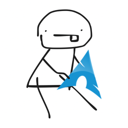
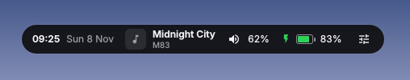
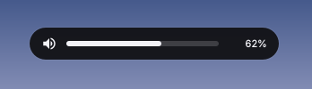
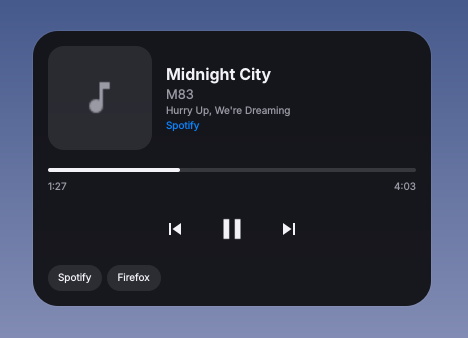
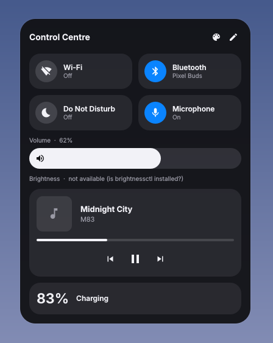
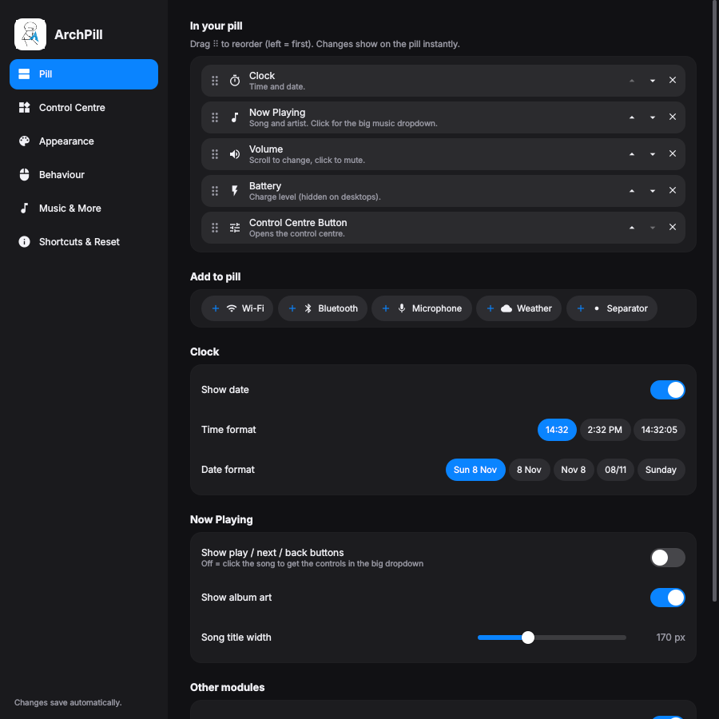
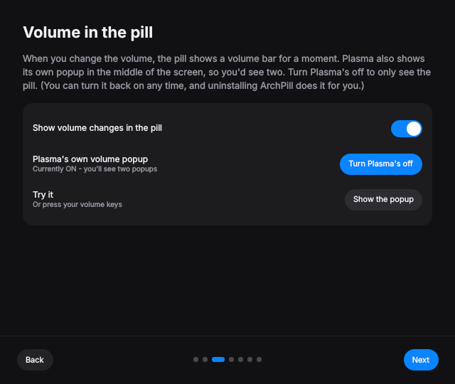

<p align="center"></p>

<h1 align="center">ArchPill</h1>

<p align="center">A Dynamic Island–style pill for Arch Linux: KDE Plasma, Hyprland, Sway, niri and more.</p>

<p align="center"></p>

---

## The super simple version

**What is it?** A little pill at the top of your screen. It shows the time,
your music, volume and battery. Click it for a control centre, like on a phone.

**Install it** (copy each line into Konsole, press Enter, wait, do the next):

```bash
git clone https://github.com/yeeboein/archpill.git ~/archpill
```
```bash
cd ~/archpill
```
```bash
./install.sh
```

A welcome window pops up and walks you through the rest. 🎉

**Use it:**
- Move your mouse to the **top-middle edge** of the screen → the pill appears.
- Click the **song** → big music player.
- Click the **sliders icon** → control centre.
- Want to change things? Open **ArchPill Settings** from your app menu.

**Remove it:**

```bash
~/archpill/uninstall.sh
```

That's it. Everything below is the detailed version.

---

## Contents

- [Screenshots](#screenshots)
- [Which desktops work](#which-desktops-work)
- [What it can do](#what-it-can-do)
- [Install (detailed)](#install-detailed)
- [Update](#update)
- [Fonts](#fonts)
- [Using ArchPill](#using-archpill)
- [Customising](#customising)
- [Volume popup & Plasma's popup](#volume-popup--plasmas-popup)
- [Keyboard shortcuts](#keyboard-shortcuts)
- [All commands](#all-commands)
- [Troubleshooting](#troubleshooting)
- [Uninstall](#uninstall)
- [Light on weak computers](#light-on-weak-computers)
- [How it's built](#how-its-built)

## Screenshots

| The pill | Volume popup |
|---|---|
|  |  |

| Music player (click the song) | Control centre |
|---|---|
|  |  |

| ArchPill Settings | Welcome tour |
|---|---|
|  |  |

> These are previews rendered with example data. Want to add real ones from
> your desktop? Take them with Spectacle and save them in `docs/screenshots/`
> with the same names.

## Which desktops work

| Desktop | Works? | Notes |
|---|---|---|
| **KDE Plasma 6** | ✅ Yes | Everything, including Plasma's own tools (Spectacle, KRunner, Night Light…) |
| **Hyprland** | ✅ Yes | Autostart is added to `hyprland.conf`. See tips below |
| **Sway** | ✅ Yes | Autostart is added to `~/.config/sway/config` |
| **niri** | ✅ Yes | Autostart is added to `config.kdl` |
| **river, Wayfire, labwc, COSMIC** | ✅ Should work | Same Wayland feature as above; less tested |
| **Xfce, Cinnamon, MATE, i3 (X11)** | ⚠️ Best effort | Quickshell's X11 support is basic |
| **GNOME** | ❌ No | GNOME doesn't let apps put panels over other windows ("layer-shell"), so the pill can't appear. The installer warns you |

ArchPill detects your desktop and picks the right tool for each widget. For
example, screenshots use Spectacle on KDE and `grim`+`slurp` (or `hyprshot`)
elsewhere; the app launcher uses KRunner, fuzzel, wofi or rofi; Night Light
uses Plasma's, GNOME's, or `hyprsunset`/`wlsunset`/`gammastep`; the clipboard
uses Klipper or `cliphist`. Widgets that can't work on your desktop are hidden
from the catalogue. On non-KDE desktops the installer also installs `grim`,
`slurp`, `wl-clipboard`, `cliphist` and a night-light tool.

**Restart / Shut Down / Log Out** ask for a second click on desktops without
their own confirmation screen.

### Tips for Hyprland, Sway and niri

- **Clipboard history** needs cliphist running. Hyprland: add
  `exec-once = wl-paste --watch cliphist store`. Sway: `exec wl-paste --watch cliphist store`.
- **Lock screen** uses `loginctl lock-session`, so your idle daemon must handle it
  (e.g. hypridle with `lock_cmd = hyprlock`, or swayidle with `lock 'swaylock'`).
- **Hyprland**: ArchPill animates itself, so you can stop Hyprland animating it
  too, and make Settings a floating window:
  ```
  layerrule = noanim, archpill
  windowrulev2 = float, class:^(archpill)$
  ```
  Want *real* blurred glass? Hyprland can blur ArchPill for you:
  `layerrule = blur, archpill` and `layerrule = ignorezero, archpill`
  (costs some GPU power).
- **Keyboard shortcuts**: `bind = SUPER, C, exec, qs -c archpill ipc call archpill toggleControlCenter`
  (Hyprland) or `bindsym $mod+c exec qs -c archpill ipc call archpill toggleControlCenter` (Sway).

## What it can do

- **The pill**: hidden until your mouse touches the top edge (or always on,
  your choice). It never covers your windows or takes screen space when hidden,
  and runs *alongside* Plasma's own panel.
- **Pill modules** (pick which and in what order): clock & date, now playing,
  volume, battery, control-centre button, Wi-Fi, Bluetooth, muted-mic warning,
  weather, separator.
- **Music**: prefers Spotify (or whichever player you choose), ignores empty
  players and the duplicate player Brave/Chrome's *Plasma Integration*
  extension creates. Click the song for a big player with album art, a progress
  bar you can click to seek, controls, and a switcher between players.
- **Volume popup**: change the volume and the pill shows a volume bar, like the
  Dynamic Island.
- **Control centre**: 50+ widgets to choose from, including Wi-Fi, Bluetooth,
  Airplane Mode, Night Light, Dark Mode, Stay Awake, Do Not Disturb, microphone,
  volume/brightness/mic sliders, sound output picker, per-app volumes, music,
  battery, clock, calendar, weather, system monitor, system info, timer,
  clipboard history, power buttons, screenshots, Overview and more. You can
  also add **any installed app** or **your own buttons** (open a website, a
  folder, or run a command).
- **ArchPill Settings app**: drag-and-drop layout for the pill and the control
  centre, 12 colour themes, every colour, sizes, corners, transparency, font,
  animation speed, behaviour and more. Changes show instantly.
- **Liquid glass look**: see-through glass, black with glass edges, or tinted
  glass, with adjustable shine and edges. It's a lightweight look-alike
  without blur, so it stays fast.
- **Updates from GitHub** with a notification and a one-click Update button.
- **Welcome tour** on first start.
- **Keyboard shortcuts** for the control centre, music, settings…
- **Starts by itself** when you log in.

## Install (detailed)

You need Arch Linux with one of the [supported desktops](#which-desktops-work).

```bash
git clone https://github.com/yeeboein/archpill.git ~/archpill
```
```bash
cd ~/archpill
```
```bash
./install.sh
```

What `install.sh` does:

1. Installs the packages it needs with `pacman`: `quickshell`, `qt6-svg`,
   `qt6-declarative`, `upower`, `pipewire`, `wireplumber`, `brightnessctl`,
   `git`, `libnotify`, plus helpers for your desktop (see above). Most are
   already installed. If
   `quickshell` isn't in your repos it uses `yay` or `paru` (AUR).
2. Copies ArchPill to `~/.config/quickshell/archpill`.
3. Creates your settings file `~/.config/archpill/config.json` (if you don't
   have one yet).
4. Makes it start at login (`~/.config/autostart`, or your Hyprland / Sway /
   niri config).
5. Adds **ArchPill** (start/restart) and **ArchPill Settings** to your app
   menu. ArchPill's windows show up as "ArchPill" with its logo (needs
   Quickshell 0.3 or newer; check with `qs --version`).
6. Starts ArchPill. The first time, the welcome tour opens.

Options:

| Command | What it does |
|---|---|
| `./install.sh --no-packages` | Skip installing packages (use this for updates) |
| `./install.sh --no-autostart` | Don't start ArchPill when you log in |
| `./install.sh --reset-config` | Back up your settings and start fresh |
| `./install.sh --no-start` | Don't start ArchPill at the end |
| `./install.sh --fonts` | Only install the big font pack (100+ font packages, see below) |

## Update

**Easy way:** ArchPill checks GitHub every few hours and sends you a
notification when there's an update. Open the control centre and press
**Update** in the blue bar at the top. ArchPill updates and restarts by itself.
(There's also a dot on the control-centre button when an update is waiting,
an *Update ArchPill* widget, and Settings → Shortcuts & Reset → *Updates*.)

**By hand:**

```bash
cd ~/archpill
```
```bash
git pull
```
```bash
./install.sh --no-packages
```

Your settings are kept. If an update fails, the details are in
`~/.cache/archpill-update.log`.

## Fonts

ArchPill can use any font on your computer (Settings → Appearance → Text).
For lots more, press **Get more fonts** there, or run:

```bash
cd ~/archpill && ./install.sh --fonts
```

It installs, from the official repos: every JetBrains Mono (normal, NL, Nerd
Font), dozens of Nerd Fonts, Inter, Roboto, Open Sans, Ubuntu, Lato, IBM Plex,
Fira, Source Sans/Serif/Code, Noto, Cascadia, Iosevka, Monaspace, OpenDyslexic,
Comic Shanns and symbol fonts (Dingbats, Font Awesome, JoyPixels…).
If you have `yay` or `paru` it also installs from the AUR: **Comic Sans MS**,
**Webdings**, Arial, Impact, Times New Roman, Georgia, Verdana, Comic Neue,
Comic Mono, Symbola and popular Google fonts (Poppins, Montserrat, Nunito,
Pacifico, Lobster, Bebas Neue…).

> Wingdings is a Windows-only font and can't be downloaded freely, so you get
> Webdings and free symbol fonts instead.

After installing, press **Restart ArchPill** in the same settings section.

## Using ArchPill

| To… | Do this |
|---|---|
| Show the pill | Move the mouse to the top-middle edge of the screen |
| Open the music player | Click the song in the pill |
| Open the control centre | Click the sliders icon, or an empty part of the pill |
| Change volume | Scroll over the volume in the pill; click it to mute |
| Close the music player / control centre | Move the mouse away |
| Edit the control centre | Pencil button in the control centre |
| Open settings | App menu → ArchPill Settings, or the palette button in the control centre |
| Wi-Fi / Bluetooth settings | Right-click their tiles |

## Customising

Open **ArchPill Settings** (app menu, or the palette button in the control
centre):

| Page | What you can change |
|---|---|
| **Pill** | Which modules are in the pill and their order (drag ⠿), clock and date format, music buttons, album art… |
| **Control Centre** | Widgets and their order, the widget catalogue (search + categories), app tiles, your own buttons |
| **Pill** (extra) | A live preview of your pill sits at the top while you edit. Separators (dot, line, space, wide space) can be added as many times as you like |
| **Appearance** | Themes, style (solid / liquid glass / black + glass edges / tinted glass), every colour, opacity, size, corner radius, padding, font (browse every installed font, or press *Get more fonts* for a free font pack), text size, animation speed |
| **Behaviour** | Always show or hover, hover area, delays, what a click does, volume popup, layer, screens |
| **Music & More** | Preferred / ignored music players, volume step, max volume, battery warning, weather location, dark/light schemes, terminal |
| **Shortcuts & Reset** | Copy-paste shortcut commands, welcome tour, open the settings file, reset everything |

Everything is saved to `~/.config/archpill/config.json`. Only the settings you
change are stored there; defaults come from `config.default.json`. You can also
edit the file by hand; ArchPill reloads it as soon as you save.

## Volume popup & Plasma's popup

When the volume changes, the pill shows a volume bar. Plasma also shows its
own popup, so you'd see two. To only see the pill:

**Easy way:** ArchPill Settings → Behaviour → *Volume popup* → **Turn Plasma's off**
(the welcome tour offers this too).

**By hand** (copy each line into Konsole):

```bash
kwriteconfig6 --notify --file plasmaparc --group General --key VolumeOsd false
```
```bash
kwriteconfig6 --notify --file plasmaparc --group General --key MuteOsd false
```

Check it worked (should print `false`):

```bash
kreadconfig6 --file plasmaparc --group General --key VolumeOsd
```

If Plasma's popup still shows, log out and back in once.

**To get Plasma's popup back:** click the same button again, run
`uninstall.sh`, or:

```bash
kwriteconfig6 --notify --file plasmaparc --group General --key VolumeOsd true
```
```bash
kwriteconfig6 --notify --file plasmaparc --group General --key MuteOsd true
```

## Keyboard shortcuts

1. Open **System Settings → Keyboard → Shortcuts**.
2. Click **Add New → Command or Script…**
3. Paste one of the commands below and choose a key.

| Shortcut idea | Command |
|---|---|
| Meta+C: control centre | `qs -c archpill ipc call archpill toggleControlCenter` |
| Meta+M: music player | `qs -c archpill ipc call archpill toggleMedia` |
| Meta+P: keep the pill shown | `qs -c archpill ipc call archpill toggle` |
| Meta+Comma: ArchPill settings | `qs -c archpill ipc call archpill openSettings` |

(ArchPill Settings → Shortcuts & Reset has **Copy** buttons for these.)

## All commands

```bash
QS_APP_ID=archpill qs -c archpill -n -d            # start ArchPill (or: app menu -> ArchPill)
qs kill -c archpill                                # stop it
qs log -c archpill                                 # show its log
qs -c archpill ipc call archpill toggleControlCenter
qs -c archpill ipc call archpill toggleMedia
qs -c archpill ipc call archpill openSettings
qs -c archpill ipc call archpill welcome            # show the welcome tour
qs -c archpill ipc call archpill toggle             # keep the pill shown / let it hide
qs -c archpill ipc call archpill show
qs -c archpill ipc call archpill hide
qs -c archpill ipc call archpill close              # close music player / control centre
qs -c archpill ipc call archpill playPause
qs -c archpill ipc call archpill next
qs -c archpill ipc call archpill previous
qs -c archpill ipc call archpill checkUpdates
qs -c archpill ipc call archpill update             # install the latest version
qs -c archpill ipc call archpill reloadConfig
```

## Troubleshooting

**The pill doesn't appear.** Check it's running:

```bash
qs list
```

If nothing is listed, start it with the log visible, and look for red lines:

```bash
qs -c archpill
```

**It doesn't start when I log in.** Check the autostart entry exists:

```bash
cat ~/.config/autostart/archpill.desktop
```

If not, run `./install.sh --no-packages` again. You can also manage it in
System Settings → Autostart.

**I see two volume popups.** See [Volume popup & Plasma's popup](#volume-popup--plasmas-popup).

**Brightness slider says "not available".** Install `brightnessctl`:

```bash
sudo pacman -S brightnessctl
```

**A widget does nothing.** Some widgets use KDE apps (Spectacle, KRunner,
Emoji picker…). Make sure the app is installed. The log shows any errors:

```bash
qs log -c archpill
```

**I broke my settings.** ArchPill Settings → Shortcuts & Reset → *Reset all
settings*, or:

```bash
cd ~/archpill && ./install.sh --no-packages --reset-config
```

## Uninstall

```bash
~/archpill/uninstall.sh
```

It stops ArchPill, removes its files, the autostart entry and the app-menu
entry, and turns Plasma's volume popup back on if ArchPill turned it off. It
asks before deleting your settings. Packages are left installed; remove
Quickshell with `sudo pacman -Rs quickshell` if you want.

## Light on weak computers

ArchPill is made for low-end laptops (tested against an Intel UHD 600 budget):

- no blur, no shadows, short simple animations (or none: Settings → Appearance → Animation → Off)
- nothing checks for changes every second: the clock ticks once a minute, Wi-Fi
  and volume react to events, and things like CPU use or brightness are only
  read while the control centre is open
- widgets only load when you add them; the settings app only exists while it's open
- the liquid glass style is made of simple gradients and lines, not blur
- the update check is one small `git fetch` every few hours

## How it's built

ArchPill is written in [Quickshell](https://quickshell.org) (QML).

```
shell.qml               starts everything, keyboard-shortcut commands
Pill.qml                the pill window (hover, expand, volume popup)
ControlCenter.qml       the control centre
MediaDropdown.qml       the big music player
Config.qml              loads/saves settings
config.default.json     default settings
modules/                things that can go in the pill
widgets/                control-centre widgets
services/               music, audio, network, weather, Plasma bridges, state
components/             shared UI pieces (icons, sliders, tiles…)
settings/               ArchPill Settings app and the welcome tour
assets/logo.png         the logo
install.sh / uninstall.sh
```

**Coming next:** showing notifications in the pill.

## License

[MIT](LICENSE)
